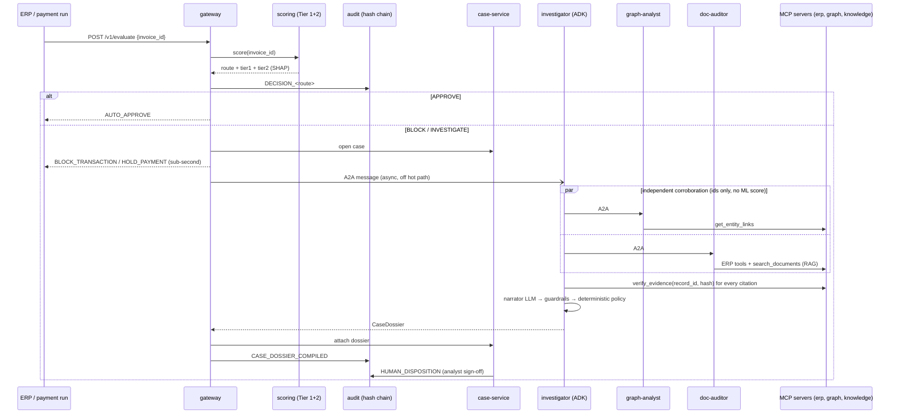

# Architecture notes

## 1. Request lifecycle

## 2. Evidence protocol

`Evidence = (source, record_id, sha256(canonical_json(record)))`, minted by the tool server that read the record. The investigator groups a report's citations by source, opens one MCP session per source and calls `verify_evidence`, which re-reads the record and re-hashes it. Then:

- invalid citation → removed; a claim left with no valid citation → removed (except `NO_ANOMALY`);
- the narrator sees **only** verified findings; its output must cite only manifest record ids and may only contain IDs and dollar amounts present in the facts/findings (`agents/narrative.py`), otherwise a deterministic template replaces it;
- the dossier's `guardrail_notes` list every intervention.

What this does *not* prove: that the model's reading of a genuine record is correct (see README, real-LLM findings).

## 3. Failure modes (what happens, and that it fails safe)

| failure | behaviour |
|---|---|
| specialist returns malformed / truncated JSON | tolerant parse → bracket repair → per-finding coercion (`OTHER_ANOMALY`); if unusable, dossier marked incomplete, action ≥ `REQUEST_MANUAL_KYC` |
| MCP tool errors | surfaced as `TOOL_ERRORS`, dossier incomplete — never read as "no anomaly" |
| model fabricates a citation / hash | dropped by hash re-verification |
| model invents an ID or amount in prose | narrative rejected, template used |
| prompt injection in a retrieved document | stripped at the MCP boundary, reported as `PROMPT_INJECTION_DETECTED` → audit hold |
| investigator unreachable / times out | 2 attempts, `INVESTIGATION_FAILED` ledger entry; case stays `INVESTIGATING`; payment already held |
| audit service down | decision still returned, `audit_unavailable` logged (alert on it) |
| bank/registry verification API down | circuit breaker opens, +0.15 risk penalty, cached/fallback verification |
| duplicate delivery of the same invoice | idempotent: same decision, same UUIDv5 key |
| scoring model missing | scoring service fails its startup — no silent default model |

## 4. Why these boundaries

- **scoring** is CPU-bound, latency-critical and stateless → scales on CPU, min instances ≥ 1, never calls an LLM.
- **investigator + specialists** are I/O- and LLM-bound, slow, bursty → scale to zero, separate A2A services so each can use a different model, prompt and tool allow-list, and can be redeployed independently.
- **MCP servers** isolate data access: the only code that touches the warehouse on behalf of an LLM is ~250 lines of typed, read-only, parameterised, PII-masking functions.
- **audit** has exactly one writer because a hash chain needs a total order.
- **case** owns human state and KPIs; **gateway** owns idempotency and routing.

## 5. ML notes

- Temporal split 65/15/20 after a 90-day history warm-up; Tier 2 is trained and scored only on invoices that pass Tier 1.
- LightGBM (`scale_pos_weight`, Platt-calibrated on the validation slice) + Isolation Forest (top-5% tail) + graph-link score, combined as a noisy-OR so independent signals only add evidence; TreeSHAP from `pred_contrib`.
- Single-row inference was the latency bottleneck: sklearn's Isolation Forest costs ~53 ms/row (per-tree joblib overhead); `ml/fast_iforest.py` precomputes node tables and is numerically identical (tested), ~1.2 ms/row. LightGBM is pinned to one thread.
- Drift: PSI with stored bin proportions (not re-derived from quantiles — that is wrong for tied/capped features) + Wasserstein, per feature.

## 6. Security

Bearer token between all services (REST, MCP, A2A); `/health`, `/metrics` and agent cards stay open. PII (tax id, IBAN, phone) is masked in tool output; graph results redact shared values for employee links. Tool allow-lists per agent plus a `before_tool_callback` audit log. Production hardening path: Cloud Run internal ingress + Direct VPC egress + OIDC identity tokens (`roles/run.invoker` per caller), Secret Manager rotation, IAP in front of the console.

## 7. Scaling notes

Hot path is stateless except SQLite (read-only) → horizontal. Replace `Warehouse` with BigQuery for history and Memorystore/Bigtable for online aggregates before exceeding a single node's page cache. Ingest from Pub/Sub by publishing invoice events to the gateway (or a push subscription). For >1 gateway instance set `DECISION_DB_URL` to Cloud SQL (already supported). Audit is intentionally a singleton; shard by entity code if one chain becomes the bottleneck.
